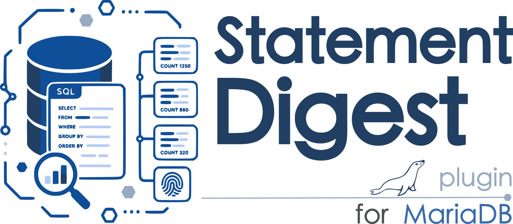

# mariadb-plugin-statement-digest



This MariaDB function plugin provides:

* `STATEMENT_DIGEST(sql_text)` — the 32-character hexadecimal digest used by
  Performance Schema statement event tables.
* `STATEMENT_DIGEST_TEXT(sql_text)` — the normalized SQL text used by
  Performance Schema statement event tables.

Both functions invoke MariaDB's parser and native digest implementation. They
return `NULL` for a `NULL` argument and report a syntax error for invalid SQL.
The `max_digest_length` server variable controls token-buffer truncation, just
as it does for normal statements.

## Build and install

Place this directory under `plugin/statement_digest` in a MariaDB server source
tree, include the directory from `plugin/CMakeLists.txt` if it is not discovered
automatically, and configure MariaDB with:

```sh
cmake -DPLUGIN_STATEMENT_DIGEST=DYNAMIC ...
cmake --build . --target statement_digest
```

Install and remove the plugin with:

```sql
INSTALL SONAME 'statement_digest';
UNINSTALL SONAME 'statement_digest';
```

No `CREATE FUNCTION` statement is needed: both functions are native function
plugins registered by the shared object.

